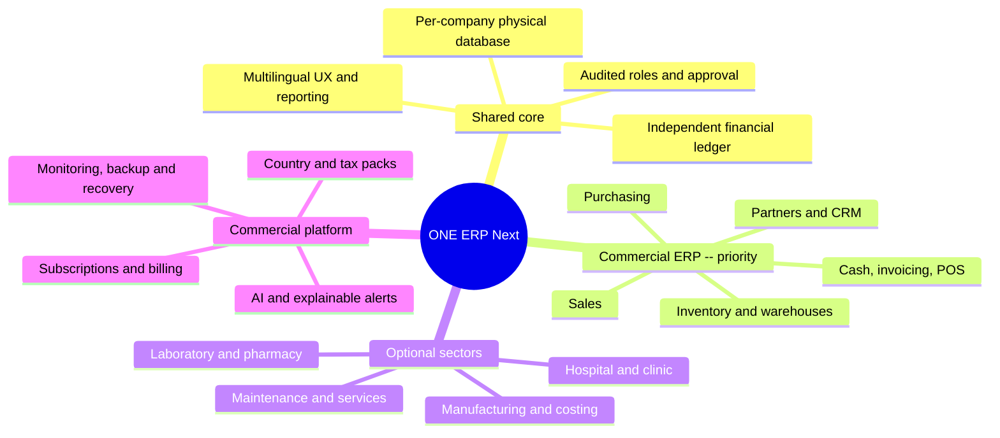

# ONE ERP Next | Project mind map and gated delivery roadmap

**Baseline:** 2026-10-15. This is the standalone ONE ERP Next project, not the legacy Odoo deployment. Commercial ERP is first; sector packs are optional and later.

## 1. Mind map

## 2. Verified project state

- Core: independent Python financial policies, invoices and payments, test-only PostgreSQL persistence, reports, isolation/identity prototypes.
- Commerce: new pure domain policies for orders, products, warehouses, partial receipts/dispatch and a PostgreSQL 14 transactional prototype in `db/005_commercial_stock.sql`, **not yet a deployed user workflow**.
- UI: GitHub Pages bilingual navigation/sector preview with invented data, **not connected** to the backend.
- Clinical/industrial: requirements and static preview only in independent ONE ERP Next, **not implemented operationally**.
- Test status: **225/225 tests successful under both Python 3.11 and 3.13** with disposable PostgreSQL 14, GitHub Actions run `38671886680`. This does not certify security, tax compliance, operations, production backups or deployment.
- All release work remains in draft development PR #20.

## 3. Tentative timeline and exit gates

Assumption: an engaged team of **3-5 full-time engineering/QA contributors**, reasonably prompt decisions, adequate funding, and external integration approvals. This is a *planning baseline*, not a contractual delivery date. A solo project will likely take substantially longer.

| Window | Track | Required evidence before progressing |
|---|---|---|
| Oct-Dec 2026 | Identity, operator authorization, tenant onboarding, independent databases | Real audited auth/approval, pinned DB and network privileges, no trust in user-supplied SQL session variables |
| Nov 2026-Apr 2027 | Complete commercial core: contacts/products, quotes, sales/purchase orders, stock, reservations, fulfillment/returns | Controlled migrations, authenticated APIs, unique event IDs, locking/concurrency tests, ledger-safe stock adjustment |
| Jan-Jun 2027 | Finance and integration: invoicing, approved tax packs, payments, statement reports | Posting traceability, transactional consistency, compliant invoice formats, region-specific legal review |
| Mar-Aug 2027 | Real UI/UX, Arabic/English, CRM, basic POS, permissions, subscriptions/trial | Connected UI, backend authorization, accessible desktop/mobile workflows and payment-confirmed entitlement changes |
| Jul-Nov 2027 | Controlled customer pilot, security, backup/recovery and uptime | Proved backup + isolated restore, TLS/DNS, monitoring, pen testing, load tests, signed release approval |
| Oct-Dec 2027 | **Conditional commercial pilot / first paid release** | All release gates pass; otherwise postpone rather than falsely claiming readiness |
| 2028 onward | Health, manufacturing, maintenance sector packs | Dedicated functional, privacy, operational and regulatory reviews. Deep inpatient hospital workflow may take longer |

Tracks overlap and dates can shift. Healthcare in 2028 is a **target for sector pilots**, not a promise of complete hospital operation.

## 4. Critical path

`verified identity → physical tenant isolation → transactional commercial workflow → finance/stock reconciliation → tax/print/payment compliance → authenticated integrated UI → tested restore/HTTPS/security → limited pilot → commercial release`.

No UI demo, positive test count or arbitrary evidence digest is sufficient to bypass these gates.

## 5. First commercial MVP scope

**Required:** independent database per company, company/user permissions, customer/supplier and product masters, sale & purchase transactions, real stock/warehouse movements, finance journals, invoicing/receipts/payables, basic finance/stock reports, Arabic/English, tested backup recovery, audit history and approved local compliance. **Not required for MVP:** full hospital administration, full factory MRP, full payroll in every country, advanced AI posting or all sector editions.

## 6. Risks and honest constraints

- Current PostgreSQL test fixture uses intentionally broad grants; production backend grants, idempotency, quota/cleanup and network isolation need review.
- No real deployment of this independent ONE ERP Next service, verified IdP, payment gateway, ZATCA interface, live backup/restore or sector pack yet.
- The release date is contingent on adequate contributors and passing independently verifiable gates.
- Preserve traceability between each new task, tests, release-gate evidence, and PR; never merge or deploy merely because a diagram milestone date arrived.

_Referenced printable Arabic mind map and timeline were generated separately from this Markdown planning source on 2026-10-15._
